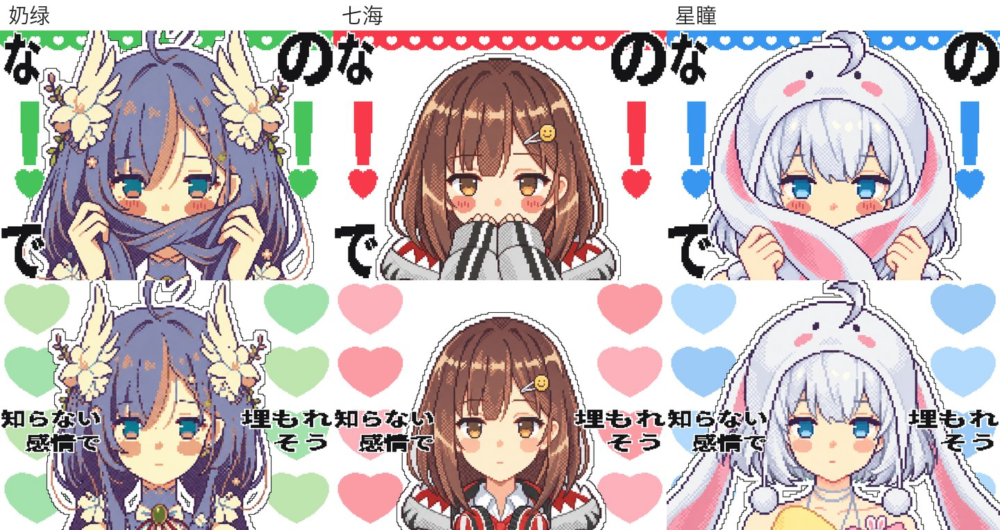

# chu无口萌MV制作分享


把一支 20.5 秒的像素风日文歌 MV 重做了一遍：音乐、切点、动作节奏都从原片逐帧量出来照做，人物换掉，表情改成「无口萌」，也就是脸几乎不动，心情全靠小动作露出来。

先做了奶绿版，再用同一套流程换角色复刻了七海版和星瞳版，验证这套流程能不能换人重用。



| | |
|---|---|
| 时长 / 画幅 | 20.5 s，1440×1080（4:3，和原片一样），30 fps |
| 镜头 | 11 个，其中 Chu 段每拍左右互切 |
| 出图 | OpenAI gpt-image 系列模型，每条提示词一次出 3 张，挑 1 张 |
| 拆片和合成 | Claude Code：让 AI 写 Python 脚本并运行（OpenCV 测量、Pillow 逐帧画、ffmpeg 出片） |
| 人做的事 | 定方向、挑图、看样片提修改 |

完整的图文流程在 [制作流程.html](制作流程.html)（下载到本地双击打开，GitHub 网页上只能看到源码）。下面是简版。

## 流程

**1. 拆原片：先量，再做。** 原片导出成 615 张图，逐帧量出：每个镜头切在哪一帧；像素有多大（原片是约 311×232 的小图放大 3.1 倍，我们的一个「大像素」约 4.6 px）；画面多久换一次（视频 30 fps，画面约 12 fps 才动一下）；镜头里怎么动（用 OpenCV 的 ECC 对齐加模板匹配，量出来只有整格平移）；转场；每句歌词在每一帧里的外框。一开始凭感觉做动作，节奏完全不对，改成逐帧测量后才对上。

**2. 定画风。** 先定一张人物主图，之后每次出图都把它当「图 1」。正式出图前先拼一张完整的风格帧，确认整体感觉。

**3. 设计动作，出图。** 动作跟歌词搭得上就行，不照搬原片。每个镜头一条英文提示词，结构固定：

1. 参考图说明：图 1 是谁、图 2 只取什么（姿势、角度或画风）、明确写不许照搬什么
2. 她是谁：发型、发色、饰品、衣服一条条写清楚，防止换脸
3. 这个镜头：取景、动作、手放在哪
4. 脸的规矩：无口，嘴是一条短线，不笑不哭
5. 画风规矩：像素颗粒和图 1 一样粗，纯色背景方便抠图

**4. 小毛病用代码改，不整张重画。** 嘴的颜色只改那几百个像素；闭眼帧用遮罩只让模型重画两只眼睛，再按像素贴回；呆毛弹跳是把那一块按拍子拉伸、压扁、回弹；害羞的腮红用代码加深一档。

**5. 一帧一帧合成。** 615 帧全部由 `animatic.py` 画出来：抠图加贴纸白边、按镜头表摆位、只在 12 fps 的格点上整格移动、Chu 段每拍心跳、转场洗白、歌词缩放进原片同一句歌词的外框（原片字幕的动效就自动带上了）、在原片闭眼的同一帧换闭眼图。整片渲染约 1 分钟。

**6. 从成片反着量一遍。** 用量原片的同一套脚本去量成片：画面突变的帧 33/36 和原片同一帧（另外 3 个是洗白帧，位置没错），Chu 段每一小步都同帧，眨眼 29/29 一致。

## 换角色复刻

同一套脚本和提示词，大部分句子不动，只换「她是谁」那一段，再按角色改了几处：

| | 七海版 | 星瞳版 |
|---|---|---|
| 爱心颜色 | 红 | 蓝（「幸せ」两个字改成从黑变绿，避免和蓝心撞色） |
| 害羞挡嘴 | 短发挡不住，改成卫衣袖子挡嘴 | 用兔子帽的两只长耳朵挡嘴 |
| 呆毛镜头 | 没有呆毛，改成鲨鱼帽弹上来扣在头上 | 用帽子顶上那根呆毛 |
| 开头的耳机 | 戴上她自己的红耳机 | 耳塞线从兔子帽下面出来 |

基底图：先照奶绿主图的画风，用角色原图出一张站姿基底图，之后每个镜头都把它当「图 1」。

复刻时踩到的坑，换别的角色时值得先注意：

- **出图背景选角色身上没有的颜色。** 浅灰卫衣、银白头发在浅灰底上抠不干净，星瞳版改用薄荷绿底，按颜色直接抠。
- **像素颗粒要写成具体数字。** 只写「和图 1 一样粗」，模型出的颗粒会细 30% 左右；写成「两眼之间约 30 格」才对上。
- **人物朝哪边转，要和参考图并排看。** 七海版第一次用原片灰度帧当姿势参考，三张都转反了；改用奶绿版同一镜头当角度参考后才对。
- **人物碰到图片边缘的地方，合成时那条边要出画。** 换了角色以后按眼距对齐大小，图片的边缘会露进画面，变成一条直直的切边（七海版开头头顶被切过一次）。人物离图边太近时，贴纸白边也会被切成直线，要先在四周留一圈透明边再描。

## 仓库里有什么

```
制作流程.html          完整图文流程（本地打开）
制作流程_图/            流程页和这个 README 的插图
成片/                   奶绿版成片
素材/                   奶绿版用到的图：人物主图、按出场顺序的 12 张镜头图、代码加工过的版本
提示词/                 进片那几张图的完整提示词、闭眼遮罩、说明.md
代码/                   测量、合成、特效、出图脚本，和歌词逐帧外框数据（text_track.json）
复刻_七海版/            结构同上：成片和与奶绿版的对照、基底图、镜头图、提示词、代码
复刻_星瞳版/            同上
```

提示词是从出图记录里原样抽出来的，就是当时实际发出去的那一段。文件头写了模型、尺寸、参考图（按顺序就是提示词里的 image 1、image 2）和入选的是第几张；参考图文件名对应仓库里哪个文件，见每个 `提示词/说明.md`。文件头里的模型名是作者那边的配置名，自己用时换成你能用的 gpt-image 模型。

## 想自己跑代码

- Python 3：Pillow、NumPy、SciPy、OpenCV；ffmpeg
- 字体：Noto Sans JP（歌词）、M PLUS Rounded 1c（Chu♡ 大字）。脚本按原工程的目录找字体，要改成你自己的路径
- 脚本按原工程的目录结构写死了路径（`assets/`、`refs/`、`work/`、`analysis/`），仓库里的图按出场顺序重新命名过，直接运行要先把文件放回原来的结构，或者改路径
- 原片不在仓库里，`SRC_VIDEO` 换成你自己的文件；原片只用来取音轨和做测量

更推荐的用法是照着流程和提示词结构，让 Claude Code 之类的 AI 编程工具按你自己的素材重写一遍。

## 版权

- 重做的是一支日文歌 MV 的 20.5 秒片段，成片用的是原曲音轨。原片画面没有放进仓库。
- 片中角色的形象归各自的权利人所有。七海、星瞳的官方形象图没有放进仓库。这是粉丝二创，不是官方作品。
- 人物图由 OpenAI 的 gpt-image 生成，图片里带有 OpenAI 写入的 C2PA 内容凭证（标明是 AI 生成）。
